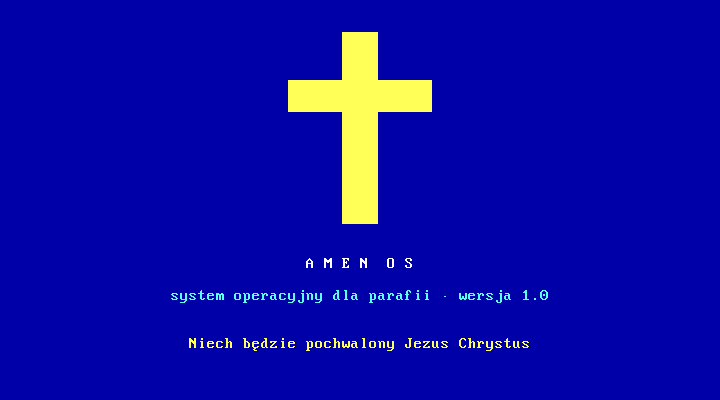
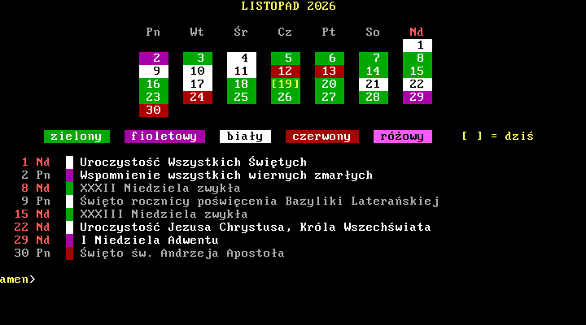
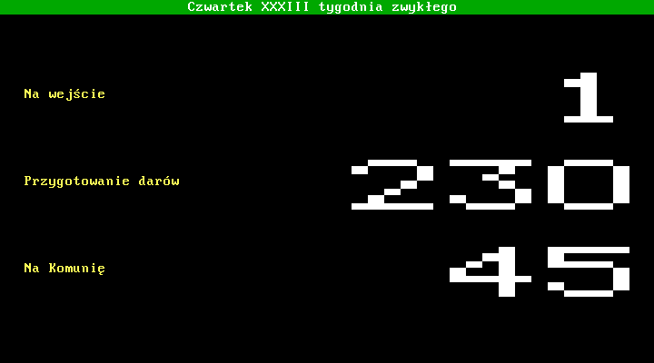
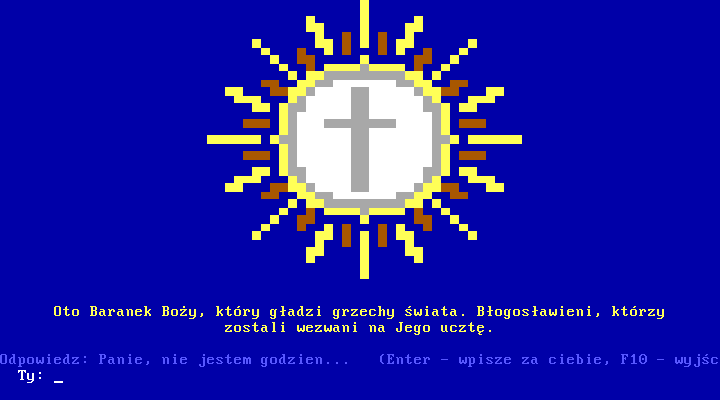

# AmenOS 1.0 — system operacyjny dla parafii

Mały system operacyjny napisany od zera (C + asembler) na komputery x86.
Nie potrzebuje Windowsa ani Linuksa — startuje prosto z pendrive'a lub płyty.
Przeznaczony na komputer w zakrystii, kancelarii albo do rzutnika/telewizora w kościele.

| | |
|---|---|
|  |  |
|  |  |
|  |  |

## Co potrafi

| Polecenie | Co robi |
|---|---|
| `dzis` | obchód liturgiczny dnia, okres, kolor szat, rok czytań (A/B/C, I/II) |
| `dzien 24.12.2026` | to samo dla dowolnej daty |
| `miesiac [MM [RRRR]]` | kalendarz miesiąca w kolorach liturgicznych + lista uroczystości |
| `kalendarz [RRRR]` | święta ruchome: Popielec, Wielkanoc, Boże Ciało, Adwent… |
| `modlitwy`, `modlitwa N` | modlitwy pełnoekranowo (Ojcze nasz, Zdrowaś Maryjo, Wierzę, Akt żalu, Spowiadam się…) |
| `piesni 101 230 45 12 9` | **tablica pieśni** dużymi cyframi na ekran/rzutnik |
| `msze`, `msze ustaw` | porządek Mszy świętych do wyświetlenia |
| `ogloszenia`, `ogloszenia dodaj …` | ogłoszenia parafialne (`usun N`, `lista`, `czysc`) |
| `spowiedz` | **wirtualny spowiednik**: wierny pisze, komputer prowadzi spowiedź, daje naukę i pokutę dobraną do grzechów i wypowiada formułę rozgrzeszenia; potem wszystko jest wymazywane z pamięci |
| `komunia` | **Komunia święta**: Hostia w promieniach, „Oto Baranek Boży”, dzwonki, „Ciało Chrystusa”, dziękczynienie z muzyką |
| `muzyka`, `muzyka N`, `muzyka wszystko` | **muzyka mszalna** z głośniczka komputera (8 utworów: wejście, Adwent, Boże Narodzenie, Wielki Post, Komunia, dziękczynienie) |
| `zegar` | duży zegar z datą i obchodem dnia |
| `parafia <nazwa>` | nazwa parafii na planszach |
| `czas`, `strefa N` | data i godzina; przesunięcie, jeśli zegar komputera chodzi wg UTC |
| `system`, `restart`, `wylacz` | informacje, ponowne uruchomienie, koniec pracy |

Polskie litery wpisuje się **prawym Altem**: Alt+a = ą, Alt+s = ś, Alt+x = ź, Alt+z = ż itd.
Strzałki góra/dół przywołują poprzednie polecenia, F1 = pomoc, Esc = wyczyść linię.

Kalendarz liczy sam: datę Wielkanocy, okresy, numery tygodni i niedziel, kolory
(łącznie z różowym na Gaudete i Laetare), rok czytań, polskie uroczystości
(św. Wojciecha, św. Stanisława, NMP Królowej Polski, MB Częstochowskiej, Wniebowstąpienie
w niedzielę) i przenoszenie uroczystości (np. Zwiastowanie po oktawie Wielkanocy).

## Jak uruchomić

**Na prawdziwym komputerze (pendrive):**
1. Zapisz `amenos.iso` na pendrive programem **Rufus** (wybierz tryb „DD”) albo **balenaEtcher**.
   Na Linuksie: `sudo dd if=amenos.iso of=/dev/sdX bs=4M status=progress`.
2. Uruchom komputer z pendrive'a (zwykle klawisz F12, F11 lub Esc przy starcie).
3. W ustawieniach BIOS/UEFI musi być włączony tryb **Legacy / CSM** — system korzysta
   z klasycznego trybu tekstowego VGA, którego nie ma w czystym UEFI.
   Większość komputerów sprzed ok. 2020 r. ma tę opcję.

**W maszynie wirtualnej (do wypróbowania):**
- QEMU: `qemu-system-i386 -cdrom amenos.iso -rtc base=localtime`
- VirtualBox: nowa maszyna „Other / Unknown”, podłącz `amenos.iso` jako płytę.

## Ważne ograniczenia

- **Dane są tylko w pamięci RAM.** Pieśni, ogłoszenia i godziny Mszy znikają po
  wyłączeniu komputera (system nie ma jeszcze obsługi dysku). Godziny Mszy i nazwę
  parafii na stałe można wpisać w `src/powloka.c` i przebudować system.
- Treść spowiedzi nie trafia do historii poleceń
  i jest zerowana w pamięci po zakończeniu lub po naciśnięciu F10.
- Muzyka gra przez wbudowany głośniczek PC (tzw. PC speaker) — jednym głosem, prostym
  dźwiękiem. Wiele nowych komputerów nie ma już głośniczka na płycie głównej;
  w QEMU: `-audiodev pa,id=s -machine pcspk-audiodev=s`.
- Melodie to głos sopranowy utworów z domeny publicznej (Bach, Gruber, Crüger),
  wygenerowane z korpusu music21 skryptem `tools/gen_muzyka.py`.
- Brak sieci, myszy i grafiki — tylko tryb tekstowy 80×25.
- Kalendarz jest **uproszczony**: zawiera wszystkie uroczystości i święta oraz
  najważniejsze wspomnienia, ale nie każde wspomnienie dowolne ani kalendarze
  diecezjalne. Do celów liturgicznych sprawdzaj z oficjalnym Ordo swojej diecezji.

## Budowanie ze źródeł (Linux)

```
sudo apt install build-essential gcc-multilib nasm grub-pc-bin grub-common xorriso mtools qemu-system-x86
make            # tworzy amenos.iso
make uruchom    # uruchamia w QEMU
```

## Budowa systemu

```
src/boot.asm        start: nagłówek Multiboot, stos, skok do C
src/kmain.c         główna funkcja jądra
src/vga.c           ekran tekstowy VGA, polskie znaki wgrywane do pamięci czcionki, printf
src/klawiatura.c    klawiatura PS/2, AltGr, edycja linii z historią
src/rtc.c           zegar CMOS
src/dzwiek.c        czasomierz PIT i głośniczek PC
src/muzyka_dane.h   nuty utworów (wygenerowane przez tools/gen_muzyka.py)
src/liturgia.c      kalendarz liturgiczny (Wielkanoc, okresy, pierwszeństwo obchodów)
src/powloka.c       wiersz poleceń i plansze (pieśni, zegar, modlitwy, ogłoszenia, msze)
src/lib.c           funkcje napisów i UTF-8 (system nie używa żadnej biblioteki C)
src/font_pl.h       kształty polskich liter (wygenerowane przez tools/gen_font.py)
linker.ld, Makefile, iso/boot/grub/grub.cfg
```

Szczęść Boże!
