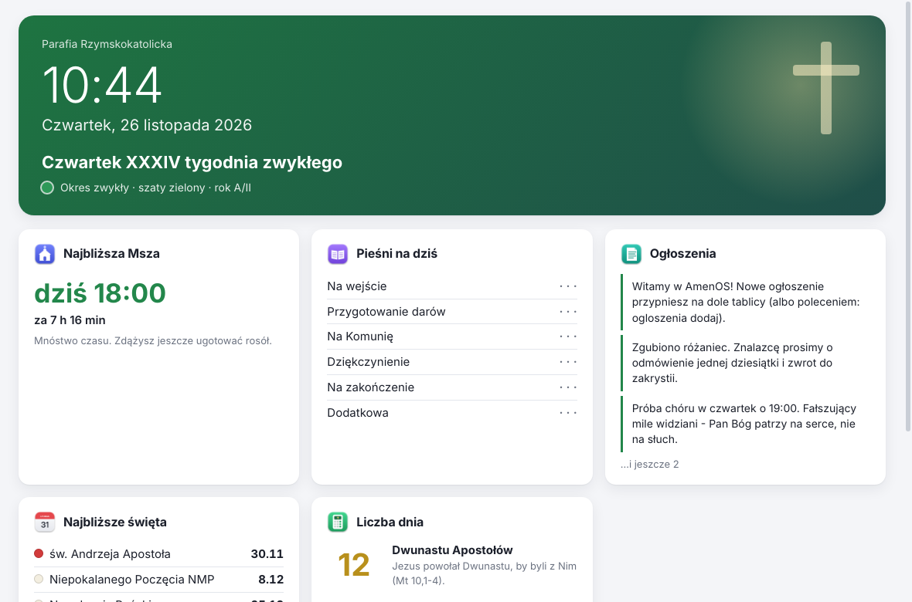
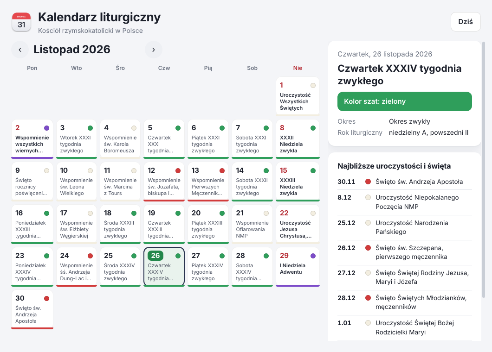
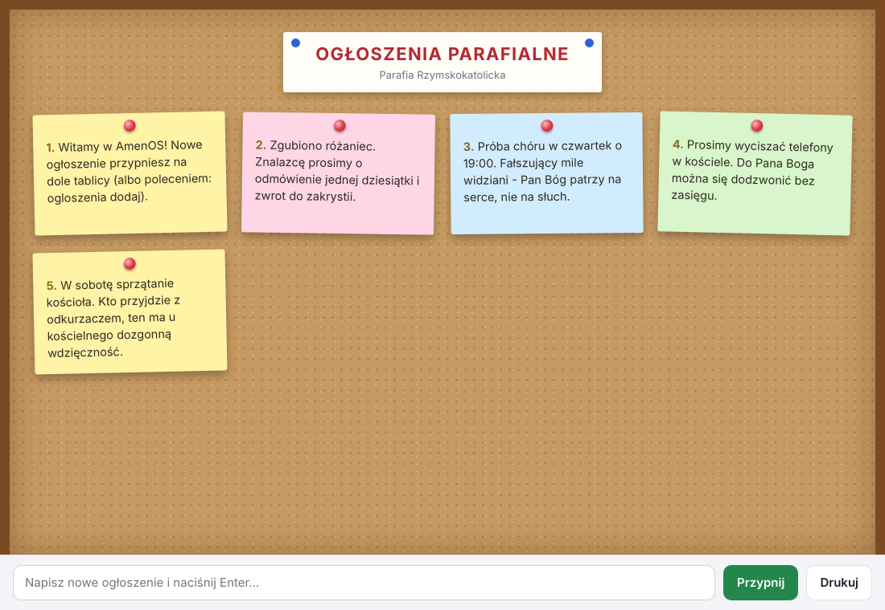
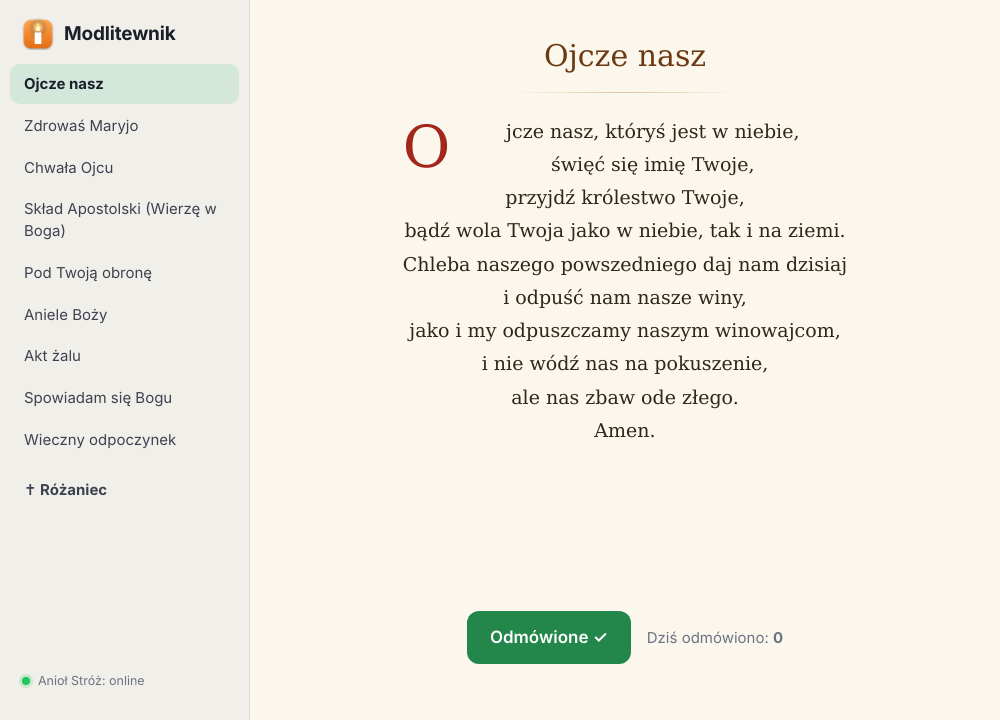
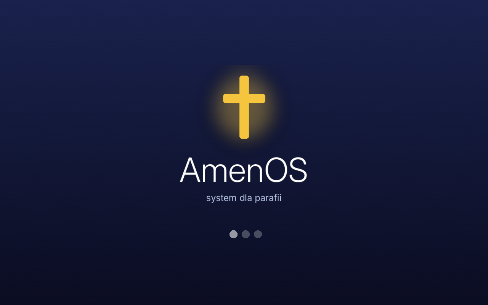
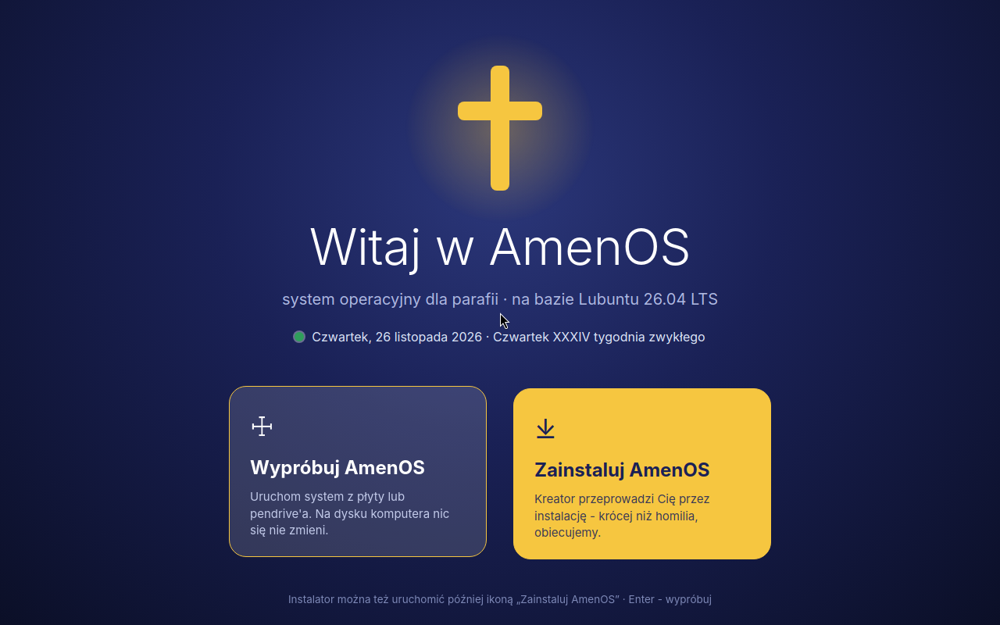

# AmenOS 3.0 ✝

**System operacyjny dla parafii** - zbudowany na **Lubuntu 26.04 LTS „Resolute Raccoon”** (pulpit LXQt, wsparcie do kwietnia 2029).

AmenOS to zwykłe, lekkie Lubuntu z polskim językiem, własnym wyglądem i zestawem programów parafialnych: od kalendarza liturgicznego, przez tablicę pieśni z widokiem na rzutnik, po spowiednika, który po rozmowie wszystko mieli w niszczarce.



## Co jest w środku

| | |
|---|---|
| **Baza** | Lubuntu 26.04 LTS (Ubuntu „resolute”), jądro Linux z `linux-generic`, LXQt 2.3 |
| **Rozruch** | BIOS i UEFI, także z włączonym **Secure Boot** (podpisane shim + GRUB) |
| **Instalator** | Calamares z motywem AmenOS, domyślnie Polska / Europe/Warsaw / klawiatura PL |
| **Wygląd** | własna tapeta, ekran startowy Plymouth, tło GRUB i ekranu logowania |
| **Przeglądarka** | Falkon (bez snapów - system działa w pełni offline) |
| **Programy parafii** | 10 aplikacji w menu **Parafia**, „Dziś w parafii” startuje po zalogowaniu |
| **Dźwięk, HDMI, Wi-Fi, drukarki** | wszystko, co obsługuje Ubuntu - PipeWire, CUPS, NetworkManager |

## Programy parafialne

Wszystkie programy to aplikacje HTML/JavaScript uruchamiane przez `amenos-app` (PyQt6 + Qt WebEngine). Działają w jednym procesie, więc można mieć otwartych kilka naraz, a zmiany (np. numery pieśni) od razu pojawiają się we wszystkich oknach - także na rzutniku.

| Program | Co robi |
|---|---|
| **Dziś w parafii** | zegar, dzień liturgiczny i kolor szat, najbliższa Msza z odliczaniem, pieśni, ogłoszenia, najbliższe święta, „liczba dnia” z Biblii |
| **Kalendarz liturgiczny** | pełny kalendarz Kościoła w Polsce (Wielkanoc, okresy, uroczystości, święta, wspomnienia, cykle czytań) |
| **Tablica pieśni** | drewniana tablica z numerami na Mszę; przycisk **Wyświetl na rzutniku** otwiera pełny ekran na drugim monitorze/HDMI |
| **Modlitewnik** | modlitwy codzienne i interaktywny **różaniec** z tajemnicami dnia |
| **Spowiedź** | rachunek sumienia w formie rozmowy; nic nie jest zapisywane, na końcu rozmowa trafia do niszczarki |
| **Komunia święta** | monstrancja, dzwonki ministranckie i komunia duchowa przy chorale Bacha |
| **Ogłoszenia parafialne** | tablica korkowa z karteczkami i wydruk na tablicę w kościele |
| **Porządek Mszy** | godziny Mszy, edycja w miejscu, odliczanie do najbliższej |
| **Kalkulator biblijny** | zwykły kalkulator, który rozpoznaje liczby z Pisma Świętego, liczy dziesięcinę, „rozmnaża” ×1000, zna liczby rzymskie i dni do Wielkanocy |
| **Muzyka mszalna** | organy z pogłosem kościoła, dzwon i 8 chorałów z domeny publicznej |

<p>
 
  
</p>

Dane parafii (nazwa, godziny Mszy, pieśni, ogłoszenia) są zapisywane lokalnie w profilu użytkownika (`~/.local/share/amenos/`).

Na komputerach bez sprzętowej grafiki (maszyny wirtualne, `nomodeset`) programy same przełączają się na rysowanie programowe. Można to wymusić zmienną `AMENOS_GPU=0` (albo `AMENOS_GPU=1`, żeby zawsze używać karty graficznej).

## Pobranie i budowa obrazu ISO

Obraz ma ok. 3 GB, więc buduje się go jednym skryptem na dowolnym Ubuntu/Debianie:

```bash
sudo apt install debootstrap squashfs-tools xorriso dosfstools mtools python3-pil
git clone https://github.com/karoljasianek/AmenOS.git && cd AmenOS
sudo ./dystrybucja/zbuduj.sh
# wynik: dystrybucja/wyniki/amenos-3.0-amd64.iso (+ .sha256)
```

Skrypt ma etapy, które można powtarzać osobno: `baza` (debootstrap), `pakiety` (Lubuntu + polski), `konfiguruj` (aplikacje, wygląd, język, instalator), `iso` (squashfs + obraz hybrydowy). Po zmianie aplikacji wystarczy `sudo ./dystrybucja/zbuduj.sh konfiguruj iso`.

Gotowy plik ISO można nagrać na pendrive (Balena Etcher, Rufus w trybie DD albo `dd`) lub uruchomić w maszynie wirtualnej:

```bash
qemu-system-x86_64 -enable-kvm -m 4G -cdrom dystrybucja/wyniki/amenos-3.0-amd64.iso                     # BIOS
qemu-system-x86_64 -enable-kvm -m 4G -bios /usr/share/ovmf/OVMF.fd -cdrom dystrybucja/wyniki/amenos-3.0-amd64.iso  # UEFI
```

Po uruchomieniu płyty pojawia się ekran powitalny z wyborem **Wypróbuj AmenOS** albo **Zainstaluj AmenOS**. Sesja na żywo loguje się automatycznie jako użytkownik `parafia`; instalator można też uruchomić później ikoną na pulpicie.

<p> </p>

## Uruchomienie programów bez instalowania systemu

Na dowolnym Linuksie z Pythonem 3 i PyQt6:

```bash
sudo apt install python3-pyqt6 python3-pyqt6.qtwebengine fonts-inter
./aplikacje/amenos-app            # Dziś w parafii
./aplikacje/amenos-app piesni     # albo: kalendarz, modlitewnik, spowiedz, komunia,
                                  #       ogloszenia, msze, kalkulator, muzyka
```

## Struktura repozytorium

```
aplikacje/          programy parafialne (HTML/JS) i program uruchamiający amenos-app
  wspolne/          wspólne style, kalendarz liturgiczny (liturgia.js), dźwięk (WebAudio), dane, ikony
  narzedzia/        wyciagnij_dane.py - generuje wspolne/dane.js z danych starego jądra
dystrybucja/        wszystko, co potrzebne do zbudowania ISO
  zbuduj.sh         skrypt budowy
  pakiety.txt       lista pakietów
  pakiet/           pakiet .deb amenos-parafia (pliki .desktop, menu „Parafia”, autostart)
  plymouth/         ekran startowy
  calamares/        motyw instalatora
  konfiguracja/     menu GRUB płyty
  wyglad/           tapeta, logo, grafiki (generuje narzedzia/gen_grafika.py)
jadro/              AmenOS 1.x-2.1 - pierwotny, własny system napisany od zera w C i asemblerze
zrzuty/             zrzuty ekranu
```

## Historia: własne jądro (wersje 1.0-2.1)

Do wersji 2.1 AmenOS był samodzielnym systemem napisanym od zera: własne jądro x86 (C + NASM), grafika 1920×1080, okna, sieć, dźwięk HDA/AC'97. Ten kod jest nadal w katalogu [`jadro/`](jadro/) i buduje się poleceniem `cd jadro && make` - opis w [jadro/README.md](jadro/README.md). Od wersji 3.0 system stoi na Lubuntu, żeby obsługiwać prawdziwy sprzęt, Wi-Fi, drukarki i instalację na dysku, a programy parafialne zostały przepisane na aplikacje HTML.

## Autor

Karol Jasianek - [github.com/karoljasianek](https://github.com/karoljasianek)

Szczęść Boże! ✝
