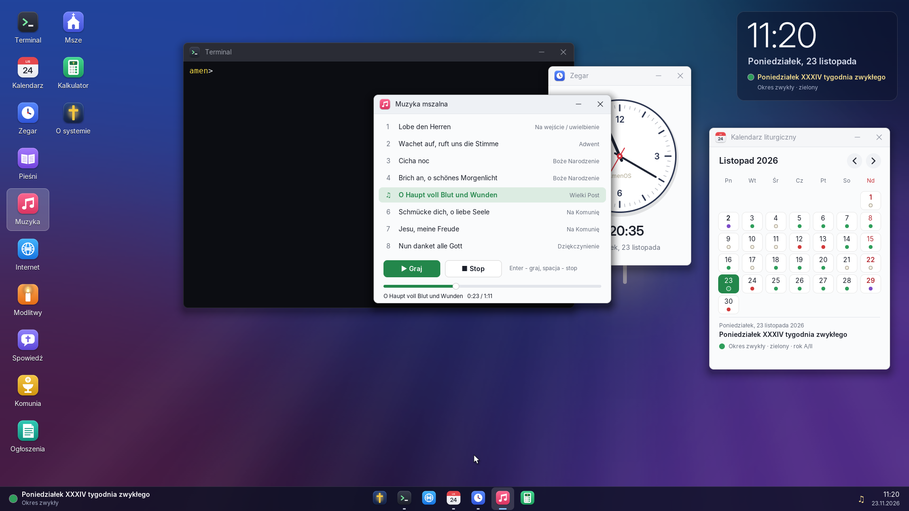
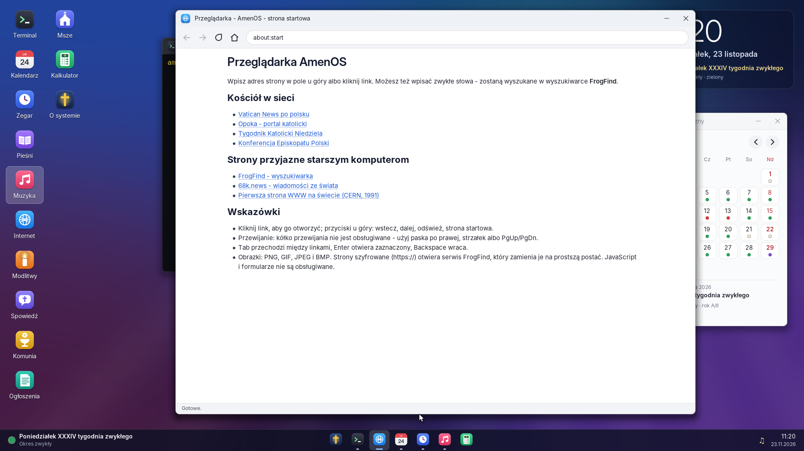
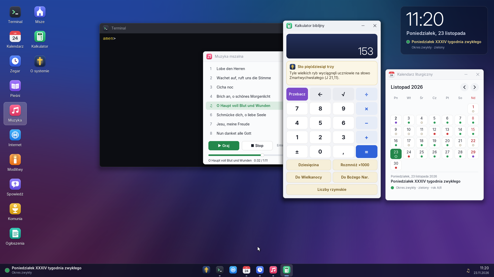
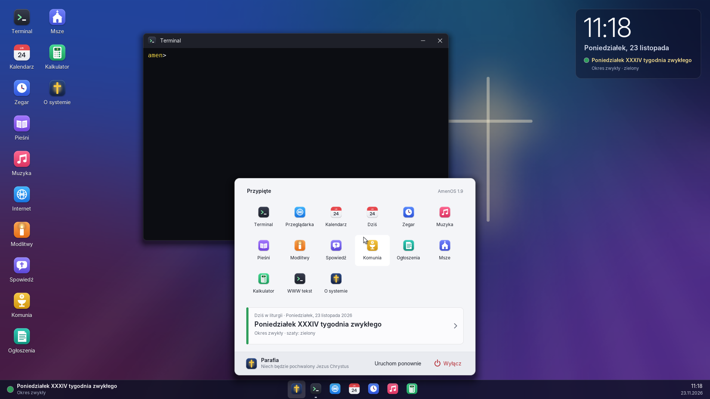
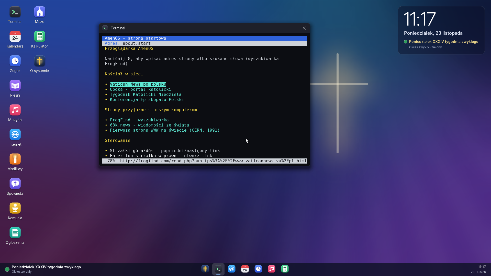
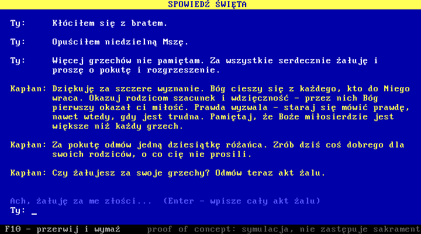
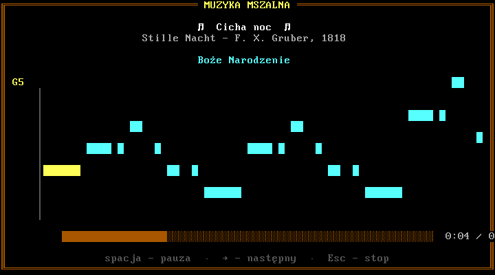
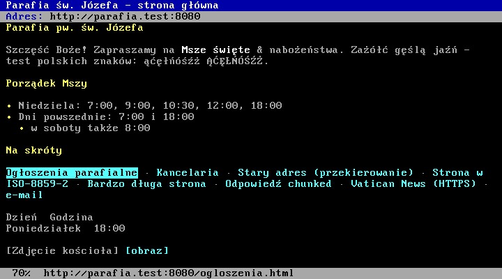
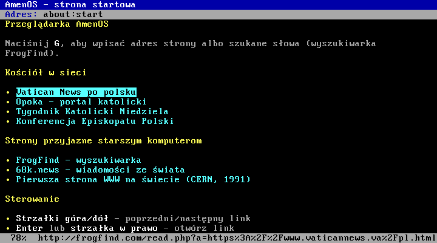
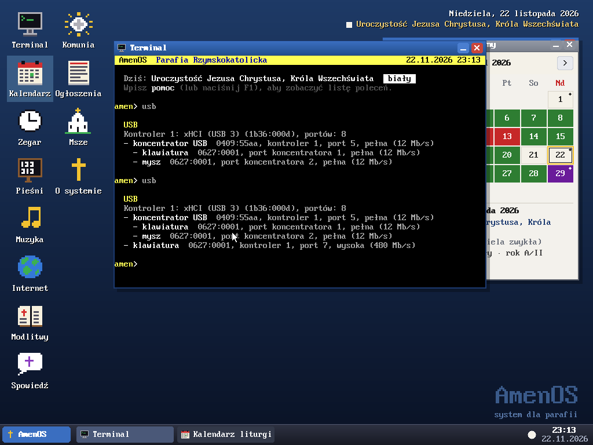

# AmenOS 1.7 — system operacyjny dla parafii

Mały system operacyjny napisany od zera (C + asembler) na komputery x86.
Nie potrzebuje Windowsa ani Linuksa — startuje prosto z pendrive'a lub płyty.
Przeznaczony na komputer w zakrystii, kancelarii albo do rzutnika/telewizora w kościele.



## Pulpit graficzny

System startuje w trybie graficznym **1920×1080** (Full HD). Jeśli karta graficzna lub monitor
nie obsługuje tej rozdzielczości, GRUB sam wybiera najlepszą dostępną (np. 1366×768, 1024×768),
a pulpit dopasowuje się do niej.

Wygląd jest nowoczesny: wygładzone czcionki (Inter), duże kolorowe ikony, okna z zaokrąglonymi
rogami i miękkim cieniem, tapeta ze świetlistym krzyżem, półprzezroczysty pasek zadań z ikonami
pośrodku, a kolor akcentu (np. dzisiejszy dzień w kalendarzu) to **kolor liturgiczny dnia**.

- **pasek zadań** — z lewej obchód dnia (kliknięcie otwiera kalendarz), pośrodku przycisk Start
  i przypięte programy (kropka pod ikoną = program otwarty), z prawej godzina i data,
- **menu Start** — siatka wszystkich programów, karta „Dziś w liturgii”, ponowne uruchomienie
  i wyłączenie komputera,
- **widżet na pulpicie** — duży zegar, data i obchód liturgiczny dnia,

- **ikony** — podwójne kliknięcie uruchamia program,
- **okna** — przeciąganie za belkę, minimalizowanie, zamykanie (także klawiszem Esc),
- **programy graficzne** — kalendarz liturgiczny (klikalny, z kolorami), zegar ze wskazówkami,
  odtwarzacz muzyki mszalnej grający w tle, okno „O systemie”,
- **przeglądarka graficzna** — strony z nagłówkami, linkami do klikania, listami, tabelami
  i **obrazkami** (JPEG, PNG, GIF, BMP), pole adresu, wstecz/dalej, przewijanie, adres linku
  pod myszą; strony HTTPS przez FrogFind (jak w przeglądarce tekstowej),
- **Kalkulator biblijny** — zwykły kalkulator (+ − × ÷, √, ±, przecinek, do 13 cyfr), który
  rozpoznaje liczby z Pisma Świętego: wynik 12 przypomina Dwunastu Apostołów (Mt 10,1-4), 153 —
  ryby z J 21,11, 77 — przebaczenie (Mt 18,22) itd. (prawie 30 liczb). Przycisk C nazywa się
  **„Przebacz”** i odpuszcza wszystkie błędy; są też przyciski **Dziesięcina** (10%),
  **Rozmnóż ×1000** (jak pięć chlebów), **Do Wielkanocy** i **Do Bożego Narodzenia** (ile dni
  zostało, liczone z zegara komputera) oraz **liczby rzymskie** (MMXXVI). Dzielenie przez zero:
  „Nieskończony jest tylko Bóg”. Działa też z klawiatury (cyfry, + - * /, Enter, Backspace, C, R),
- **Terminal** — dotychczasowa powłoka w oknie; wszystkie programy tekstowe (przeglądarka,
  spowiedź, Komunia, tablica pieśni, modlitwy, ogłoszenia…) działają w nim i można je uruchamiać
  ikonami z pulpitu albo z menu Start.

Jeśli karta graficzna nie obsługuje trybu graficznego, w menu startowym GRUB-a jest pozycja
**„AmenOS - tryb tekstowy”**, która uruchamia system jak dawniej (80×25 znaków).

| | |
|---|---|
|  |  |
|  |  |
|  |  |
|  |  |
|  |  |
|  |  |
|  | |

## Co potrafi

| Polecenie | Co robi |
|---|---|
| `dzis` | obchód liturgiczny dnia, okres, kolor szat, rok czytań (A/B/C, I/II) |
| `dzien 24.12.2026` | to samo dla dowolnej daty |
| `miesiac [MM [RRRR]]` | kalendarz miesiąca w kolorach liturgicznych + lista uroczystości |
| `kalendarz [RRRR]` | święta ruchome: Popielec, Wielkanoc, Boże Ciało, Adwent… |
| `modlitwy`, `modlitwa N` | modlitwy pełnoekranowo (Ojcze nasz, Zdrowaś Maryjo, Wierzę, Akt żalu, Spowiadam się…) |
| `piesni 101 230 45 12 9` | **tablica pieśni** dużymi cyframi na ekran/rzutnik |
| `msze`, `msze ustaw` | porządek Mszy świętych do wyświetlenia |
| `ogloszenia`, `ogloszenia dodaj …` | ogłoszenia parafialne (`usun N`, `lista`, `czysc`) |
| `spowiedz` | **wirtualny spowiednik**: wierny pisze, komputer prowadzi spowiedź, daje naukę i pokutę dobraną do grzechów i wypowiada formułę rozgrzeszenia; potem wszystko jest wymazywane z pamięci |
| `komunia` | **Komunia święta**: Hostia w promieniach, „Oto Baranek Boży”, dzwonki, „Ciało Chrystusa”, dziękczynienie z muzyką |
| `muzyka`, `muzyka N`, `muzyka wszystko` | **muzyka mszalna** z głośniczka komputera (8 utworów: wejście, Adwent, Boże Narodzenie, Wielki Post, Komunia, dziękczynienie) |
| `www [adres]` | **przeglądarka tekstowa** w terminalu: linki, historia, wyszukiwanie; strony HTTPS przez FrogFind (graficzna: ikona „Internet” na pulpicie) |
| `usb` | kontrolery USB i podłączone klawiatury, myszy, koncentratory |
| `siec`, `ping ADRES`, `siec dns A.B.C.D` | stan sieci (adres z DHCP), test połączenia, własny serwer DNS |
| `zegar` | duży zegar z datą i obchodem dnia |
| `parafia <nazwa>` | nazwa parafii na planszach |
| `czas`, `strefa N` | data i godzina; przesunięcie, jeśli zegar komputera chodzi wg UTC |
| `system`, `restart`, `wylacz` | informacje, ponowne uruchomienie, koniec pracy |

Polskie litery wpisuje się **prawym Altem**: Alt+a = ą, Alt+s = ś, Alt+x = ź, Alt+z = ż itd.
Strzałki góra/dół przywołują poprzednie polecenia, F1 = pomoc, Esc = wyczyść linię.

Kalendarz liczy sam: datę Wielkanocy, okresy, numery tygodni i niedziel, kolory
(łącznie z różowym na Gaudete i Laetare), rok czytań, polskie uroczystości
(św. Wojciecha, św. Stanisława, NMP Królowej Polski, MB Częstochowskiej, Wniebowstąpienie
w niedzielę) i przenoszenie uroczystości (np. Zwiastowanie po oktawie Wielkanocy).

## Jak uruchomić

**Na prawdziwym komputerze (pendrive):**
1. Zapisz `amenos.iso` na pendrive programem **Rufus** (wybierz tryb „DD”) albo **balenaEtcher**.
   Na Linuksie: `sudo dd if=amenos.iso of=/dev/sdX bs=4M status=progress`.
2. Uruchom komputer z pendrive'a (zwykle klawisz F12, F11 lub Esc przy starcie).
3. W ustawieniach BIOS/UEFI musi być włączony tryb **Legacy / CSM** — system korzysta
   z klasycznego trybu tekstowego VGA, którego nie ma w czystym UEFI.
   Większość komputerów sprzed ok. 2020 r. ma tę opcję.

**W maszynie wirtualnej (do wypróbowania):**
- QEMU: `qemu-system-i386 -cdrom amenos.iso -rtc base=localtime -nic user,model=e1000`
- VirtualBox: nowa maszyna „Other / Unknown”, podłącz `amenos.iso` jako płytę; karta sieciowa
  „Intel PRO/1000 MT Desktop” (domyślna), tryb NAT.

## Ważne ograniczenia

- **Dane są tylko w pamięci RAM.** Pieśni, ogłoszenia i godziny Mszy znikają po
  wyłączeniu komputera (system nie ma jeszcze obsługi dysku). Godziny Mszy i nazwę
  parafii na stałe można wpisać w `src/powloka.c` i przebudować system.
- Treść spowiedzi nie trafia do historii poleceń
  i jest zerowana w pamięci po zakończeniu lub po naciśnięciu F10.
- Muzyka gra przez wbudowany głośniczek PC (tzw. PC speaker) — jednym głosem, prostym
  dźwiękiem. Wiele nowych komputerów nie ma już głośniczka na płycie głównej;
  w QEMU: `-audiodev pa,id=s -machine pcspk-audiodev=s`.
- Melodie to głos sopranowy utworów z domeny publicznej (Bach, Gruber, Crüger),
  wygenerowane z korpusu music21 skryptem `tools/gen_muzyka.py`.
- Sieć działa z kartą **Intel PRO/1000 (e1000, rodzina 8254x)** — domyślną w QEMU
  i VirtualBox, spotykaną w starszych komputerach. Inne karty nie są jeszcze obsługiwane.
  Adres IP jest pobierany automatycznie (DHCP).
- Przeglądarka obsługuje zwykłe HTTP. Strony **HTTPS** (większość dzisiejszych) są otwierane
  przez zewnętrzny serwis [FrogFind](http://frogfind.com), który pobiera je i upraszcza do
  tekstu — adresy tych stron trafiają więc do tego serwisu. Brak JavaScriptu i formularzy.
- Przeglądarka graficzna: obrazki JPEG (bez progresywnych), PNG (bez przeplotu), GIF (pierwsza
  klatka) i BMP; jedna czcionka 8×16 (nagłówek 1. stopnia powiększony), bez CSS i kółka myszy.
  Potrzebuje ok. 48 MB pamięci RAM — przy mniejszej pokazuje komunikat.
- Pulpit wymaga karty graficznej z VBE (praktycznie każda karta od ok. 2000 r., QEMU, VirtualBox).
- Pulpit w 1920×1080 zajmuje ok. 17 MB RAM na obraz ekranu i tapetę; razem z przeglądarką
  graficzną zalecane jest co najmniej 128 MB pamięci.
- **Klawiatury i myszy USB** obsługiwane są bezpośrednio przez kontrolery **xHCI** (USB 3, komputery
  od ok. 2012 r.) i **UHCI** (starsze komputery z chipsetami Intel/VIA), także przez **koncentratory**
  (hub w monitorze, KVM, listwa USB) i z podłączaniem w trakcie pracy. Urządzenia działają w trybie
  „boot” HID — obsługuje go praktycznie każda klawiatura i mysz (także odbiorniki bezprzewodowe).
  Kontrolery OHCI (niektóre płyty AMD/SiS/NVIDIA) i tablety USB (np. „USB Tablet” w VirtualBox)
  nie są jeszcze obsługiwane — w VirtualBox wybierz mysz PS/2 albo „USB Mouse”.
- Jeśli coś pójdzie nie tak z USB, w menu startowym jest pozycja **„bez sterowników USB”** —
  wtedy klawiatura i mysz działają tak jak dawniej, przez emulację PS/2 w BIOS-ie.
- Kalendarz jest **uproszczony**: zawiera wszystkie uroczystości i święta oraz
  najważniejsze wspomnienia, ale nie każde wspomnienie dowolne ani kalendarze
  diecezjalne. Do celów liturgicznych sprawdzaj z oficjalnym Ordo swojej diecezji.

## Budowanie ze źródeł (Linux)

```
sudo apt install build-essential gcc-multilib nasm grub-pc-bin grub-common xorriso mtools qemu-system-x86
make            # tworzy amenos.iso
make uruchom    # uruchamia w QEMU (sieć e1000, klawiatura i mysz USB na xHCI)
```

## Budowa systemu

```
src/boot.asm        start: nagłówek Multiboot, stos, skok do C
src/kmain.c         główna funkcja jądra
src/vga.c           ekran tekstowy VGA, polskie znaki wgrywane do pamięci czcionki, printf
src/klawiatura.c    klawiatura i mysz PS/2, AltGr, edycja linii z historią
src/usb.c           warstwa USB: wykrywanie, deskryptory, koncentratory, klawiatura i mysz HID
src/xhci.c          sterownik kontrolera xHCI (USB 3)
src/uhci.c          sterownik kontrolera UHCI (USB 1.1); EHCI oddaje mu porty
src/pci.c           dostęp do konfiguracji PCI
src/www_gui.c       przeglądarka graficzna: HTML → elementy → układ w pikselach, okno
src/obrazy.c        dekodery obrazków: inflate+PNG, GIF (LZW), JPEG baseline (IDCT), BMP
src/www.h           wspólne pobieranie HTTP i narzędzia obu przeglądarek
src/rtc.c           zegar CMOS
src/dzwiek.c        czasomierz PIT i głośniczek PC
src/muzyka_dane.h   nuty utworów (wygenerowane przez tools/gen_muzyka.py)
src/e1000.c         sterownik karty sieciowej Intel PRO/1000 (PCI)
src/siec.c          stos sieciowy: ARP, IPv4, ICMP, UDP, DHCP, DNS, TCP
src/przegladarka.c  przeglądarka: HTTP, HTML, linki, historia
src/znaki_dane.h    kodowania ISO-8859-2 / Windows-1250 (tools/gen_znaki.py)
src/fb.c            grafika: bufor ramki od GRUB-a (VBE), podwójne buforowanie, rysowanie
src/gui.c           pulpit: okna, ikony, pasek zadań, menu Start, programy graficzne
src/kalkulator.c    kalkulator biblijny (liczby stałoprzecinkowe 64-bitowe)
src/grafika_dane.h  czcionka 8x16, ikony i tabela sinusów (tools/gen_grafika.py)
src/wyglad_dane.h   czcionki wygładzane, czcionka terminala, ikony, kursor, tapeta (tools/gen_wyglad.py)
src/liturgia.c      kalendarz liturgiczny (Wielkanoc, okresy, pierwszeństwo obchodów)
src/powloka.c       wiersz poleceń i plansze (pieśni, zegar, modlitwy, ogłoszenia, msze)
src/lib.c           funkcje napisów i UTF-8 (system nie używa żadnej biblioteki C)
src/font_pl.h       kształty polskich liter (wygenerowane przez tools/gen_font.py)
linker.ld, Makefile, iso/boot/grub/grub.cfg
```

Czcionki pulpitu: [Inter](https://rsms.me/inter/) (SIL Open Font License) i DejaVu Sans Mono
(licencja Bitstream Vera) — w systemie są zapisane jako gotowe bitmapy wygenerowane przez
`tools/gen_wyglad.py`.

Szczęść Boże!
